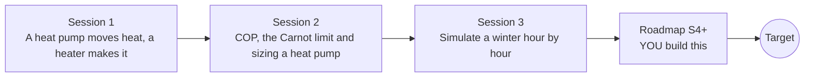

# openheatpump

[](https://github.com/KrunalPanchal1995/openheatpump/actions/workflows/ci.yml)   [](https://colab.research.google.com/github/KrunalPanchal1995/openheatpump/blob/main/sessions/session-01/lesson.ipynb) [](https://krunalpanchal1995.github.io/openheatpump/)

**Size a heat pump and see why it beats a heater, in three sessions.**

openheatpump teaches why one kilowatt-hour of electricity can deliver three or four kilowatt-hours of heat, how to size a heat pump for a house, and how to simulate its winter, using only Python and a browser.

- **Start from the big idea.** Session 1 needs only school arithmetic: a heat pump moves heat instead of making it.
- **See it move.** Every session ships a slider app that runs in the browser, with labelled graphs.
- **Know you got it right.** Each session ends with a checkpoint that prints PASS or FAIL against hand calculations and energy conservation.
- **Build the missing half.** The repo stops at Session 3 on purpose; the roadmap shows the path to the Target.

[Target](#the-target) · [Who is this for](#who-is-this-for) · [Quick start](#quick-start) · [Sessions](#sessions) · [Roadmap](#roadmap) · [Contribute](#contribute) · [Explainer PDF](docs/explainer.pdf)

> **This repo is incomplete on purpose.** Sessions 1 to 3 are here and fully working. The finished Target below is a preview of what the community can build next. We show you the path, not the code. Sessions 4 and up are yours.

## The Target

An animated cold winter week for a house with a heat pump and a resistance heater side by side. The top panel shows the outdoor temperature and the indoor temperature (20 C by day, 17 C at night). The middle panel shows the heat pump COP sagging on the coldest nights. The bottom panel adds up the cost: by the end of the week the heater has cost about three times as much. Your goal over the coming sessions: build that animation yourself, with a house that stores heat, a weather-compensated supply temperature and a backup heater.


*Target: a cold winter week, heat pump versus resistance heater*


*Target, final frame: temperatures, COP and cumulative cost*

Try it live:

- [Math Visual Studio: the second law and entropy (Atlas S54)](https://krunalpanchal1995.github.io/studio/#atlas?ch=S54&ex=1)
- [Math Visual Studio: thermodynamic cycles (Atlas S55)](https://krunalpanchal1995.github.io/studio/#atlas?ch=S55&ex=1)

How the Target was made is shown only as a path in [promo/roadmap.md](promo/roadmap.md).

## Who is this for
**higher secondary to diploma / undergraduate (levels 4-5).** Topic area: Heat, Thermodynamics and Fluid Mechanics.

Prerequisites:

- School arithmetic and the idea of a temperature scale; Session 2 adds simple algebra and kelvin.
- Python 3.10 or newer; if `python --version` works, you are ready. PRIMER.md explains the rest.
- No prior thermodynamics, GitHub or numerical-methods experience is needed.

New to Python? Read [PRIMER.md](PRIMER.md) first (10 minutes).

## Quick start

No installation knowledge needed. You need [Git](https://git-scm.com/downloads) and [Python 3.10+](https://www.python.org/downloads/) (Windows: tick "Add Python to PATH"). On Mac and Linux type `python3` wherever this page says `python`.

```bash
git clone https://github.com/KrunalPanchal1995/openheatpump.git
cd openheatpump
python start.py 1
```

`start.py` creates a private environment, installs what is needed and runs Session 1 with its checkpoint. Next: `python start.py 2`, `python start.py 3`, or `python start.py test` to check everything. Only a checkpoint: `python start.py check 1`.

Four lines turn the idea of Session 1 into a result (they work as they are): Save it as `try.py` and run it with `python start.py run try.py` (this uses the private environment, where NumPy is installed):

```python
cop = 0.45 * (35 + 273.15) / (35 - 0)      # real COP = 0.45 x Carnot, 35 C supply, 0 C outdoors
electric = 10 / cop                          # kWh of electricity for 10 kWh of heat
print(round(cop, 2), round(electric, 2))     # -> 3.96 2.52
print('a resistance heater needs 10.00 kWh')
```

Every session also opens in your browser with sliders (no install): [live apps](https://krunalpanchal1995.github.io/openheatpump/). Or use the Colab badge above for the notebook.

## Sessions

| # | Session | Model level | Time | Live app |
|---|---|---|---|---|
| 1 | [A heat pump moves heat, a heater makes it](sessions/session-01/README.md) | Level 1: conceptual interactive model | 60 min | [open](https://krunalpanchal1995.github.io/openheatpump/session-01/) |
| 2 | [COP, the Carnot limit and sizing a heat pump](sessions/session-02/README.md) | Level 2: mathematical engineering model | 75 min | [open](https://krunalpanchal1995.github.io/openheatpump/session-02/) |
| 3 | [Simulate a winter hour by hour](sessions/session-03/README.md) | Level 3: simulation and validation | 90 min | [open](https://krunalpanchal1995.github.io/openheatpump/session-03/) |

Each session follows the same six steps: A real-world problem, B concept and theory, C visual explanation, D interactive simulation, E worked example and experiment, F assessment and design challenge. Each ends with `checkpoint.py`, which prints `PASS` or `FAIL` against reference numbers. Session 3 also contains the real-world mini-project: **Size a heat pump for a house and estimate its yearly heating cost**.

## Architecture



| Folder or file | What is inside |
|---|---|
| `sessions/` | three sessions: README (A-F), `lesson.py`, notebook, live app, exercises, activity sheet, checkpoint |
| `promo/` | the Target: media, live links, and the roadmap (path only) |
| `docs/` | `explainer.tex` and the built `explainer.pdf` |
| `tests/` | runs every lesson and checkpoint headless |
| `start.py` | one command to set up and run anything |
| `QUALITY.md`, `RUBRIC.md` | the quality checklist and the scoring rubric |
| `.github/` | CI, PDF build, Pages deploy, issue and PR templates |

## Roadmap

| Milestone | What you will build | Difficulty |
|---|---|---|
| Session 4: Weather-compensated supply temperature | A supply temperature that rises linearly as the outdoor temperature falls, limited to 30 to 45 C, used inside the hourly simulation. | intermediate |
| Session 5: On/off thermostat with minimum run time | A hysteresis thermostat at a sub-hourly step that switches the heat pump fully on or off. | intermediate |
| Session 6: Capital cost and the best size | A cost model with a price per kW of rated capacity added to the running cost over several winters. | intermediate |
| Session 7: Make the daily model honest | A correction to the Session 2 daily method (for example a daily-swing and defrost adjustment) tuned against the hourly simulation. | advanced |
| Session 8: Two-node house and night setback | A two-capacity house model with a 17 C night set point, integrated with a fourth-order method at a sub-hourly step, drawn like the Target. | advanced |

Full detail with a checkpoint per milestone: [promo/roadmap.md](promo/roadmap.md).

## Contribute
New to GitHub? Read [CONTRIBUTING.md](CONTRIBUTING.md); it starts from zero. Pick an issue labelled `good first issue`. Translations into Hindi, Telugu, Tamil and Malayalam are welcome.

<details>
<summary>Development</summary>

```bash
python start.py test        # runs every lesson and checkpoint
```
Lessons use `# %%` cell markers so they open as notebooks in VS Code. See [QUALITY.md](QUALITY.md) for the standard every session meets.
</details>

## License
MIT. See [LICENSE](LICENSE). Media in `promo/media` is (c) Krunal Panchal, CC BY 4.0.

## Acknowledgments
Part of the [PAN IIT OSS](https://hellofoss.tech-iitb.org/projects) open-source teaching collection, modelled on the structure of [openspline](https://github.com/openspline/openspline). Built on ideas from the Math Visual Studio at https://krunalpanchal1995.github.io/studio/.
