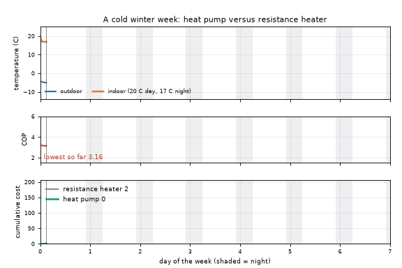
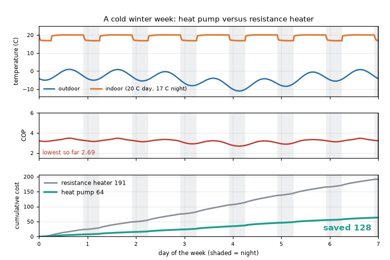

# What you are building toward

An animated cold winter week for a house with a heat pump and a resistance heater side by side. The top panel shows the outdoor temperature and the indoor temperature (20 C by day, 17 C at night). The middle panel shows the heat pump COP sagging on the coldest nights. The bottom panel adds up the cost: by the end of the week the heater has cost about three times as much. Your goal over the coming sessions: build that animation yourself, with a house that stores heat, a weather-compensated supply temperature and a backup heater.

*Target: a cold winter week, heat pump versus resistance heater*

*Target, final frame: temperatures, COP and cumulative cost*

These results come from a private reference build. The code is not published; the roadmap shows the path so you can build your own.

Live links:

- [Math Visual Studio: the second law and entropy (Atlas S54)](https://krunalpanchal1995.github.io/studio/#atlas?ch=S54&ex=1)
- [Math Visual Studio: thermodynamic cycles (Atlas S55)](https://krunalpanchal1995.github.io/studio/#atlas?ch=S55&ex=1)
