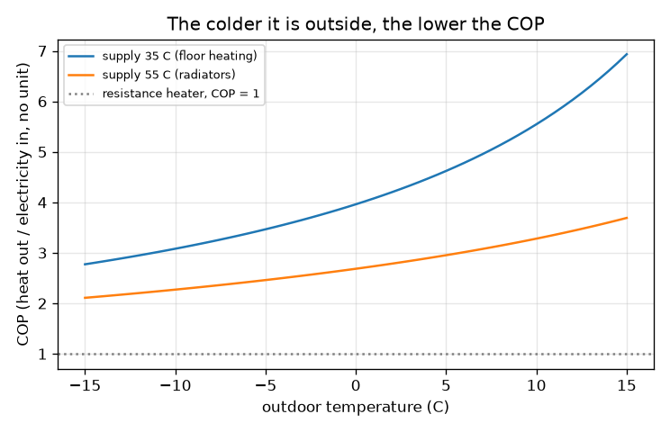
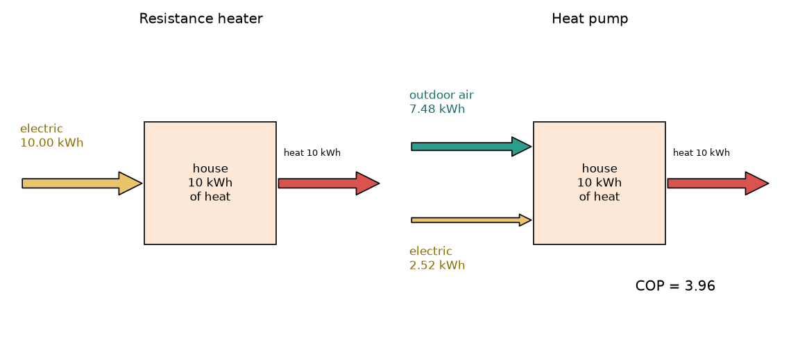

# Session 1: A heat pump moves heat, a heater makes it

*Level 1 (conceptual interactive model) · about 60 minutes · openheatpump*

> This is a simplified educational model. It is not a validated design tool and must not be used for real structures, electrical installations, vehicles, industrial processes or medical decisions.

**Prerequisites**

- School arithmetic (multiplying, dividing, percentages).
- You have read PRIMER.md and run `python start.py 1` once.

**Learning objectives.** After this session you can:

- Explain why a resistance heater gives 1 kWh of heat per kWh of electricity and a heat pump can give several.
- Define the COP and use Q = COP x W to find the electricity needed for a given heat.
- Draw the energy flows of a heat pump: electric in, outdoor heat in, indoor heat out.
- Read a graph of COP against outdoor temperature and say why it falls when it gets colder.

## A. Real-world problem
On a cold day a room needs 10 kWh of heat. An electric resistance heater turns every kWh of electricity into exactly 1 kWh of heat, so it uses 10 kWh. A heat pump delivers the same 10 kWh while using only about a quarter of that electricity. That sounds like free energy, so where does the rest of the heat come from, and why does the saving shrink when the weather turns colder? (General education about a simplified model, not an installation design.)

## B. Concept and theory
A resistance heater makes heat: all the electrical energy W becomes heat, so heat out equals W. A heat pump does not make the heat; it moves it from the cold outdoor air into the warm house, much as a pump lifts water uphill, using electricity to do the lifting. The heat delivered is Q_hot = W + Q_outdoor, so energy is conserved. The coefficient of performance is COP = Q_hot / W: the kWh of heat per kWh of electricity. For a heater COP = 1. The lift is the temperature gap between the delivered (supply) temperature and the outdoor temperature; the bigger the gap, the harder the pump works and the lower the COP. The best possible COP for a given gap is T_hot / (T_hot - T_cold) with temperatures in kelvin (K = C + 273.15); real machines reach roughly 40 to 50 percent of it, and we use 0.45 as a typical value.

| Symbol | Meaning | Unit |
|---|---|---|
| W | electrical energy used | kWh |
| Q_hot | heat delivered to the house | kWh |
| Q_outdoor | heat taken from the outdoor air | kWh |
| COP | coefficient of performance, Q_hot / W | no unit |
| T_supply, T_out | temperature of the delivered heat and of the outdoor air | degrees C (kelvin in the formula) |
| eta | fraction of the best possible COP a real machine reaches (typical 0.4 to 0.5) | no unit |

**Assumptions**

- The 0.45 fraction is a typical value, not the figure of any particular machine.
- Steady operation: no defrost, no fan or pump power, no start-up losses.
- The supply temperature (35 C for floor heating, 55 C for radiators) is fixed.

$$ Q_{\text{hot}}=W+Q_{\text{outdoor}}\qquad \mathrm{COP}=\frac{Q_{\text{hot}}}{W}\qquad W=\frac{Q_{\text{hot}}}{\mathrm{COP}} $$

$$ \mathrm{COP}_{\text{best}}=\frac{T_{\text{supply}}}{T_{\text{supply}}-T_{\text{out}}},\qquad T[\mathrm{K}]=T[^\circ\mathrm{C}]+273.15 $$

$$ \mathrm{COP}\approx \eta\,\frac{T_{\text{supply}}}{T_{\text{supply}}-T_{\text{out}}},\qquad \eta\approx 0.45 $$

## C. Visual explanation
The first figure draws the two machines side by side for 10 kWh of heat. The heater has one yellow electric arrow of 10 kWh. The heat pump has a thin yellow electric arrow of 2.52 kWh and a thick teal arrow of 7.48 kWh of heat taken from the outdoor air; the red arrow carries 10 kWh into the house in both cases. The second figure plots the COP against the outdoor temperature for 35 C and 55 C supply: both curves fall as it gets colder, and the 55 C curve sits well below the 35 C curve.

*COP against outdoor temperature for 35 C and 55 C supply.*

*Energy flows for 10 kWh of heat: heater (left) and heat pump (right) at 0 C outdoors, 35 C supply.*

## D. Interactive simulation
Run the lesson (`python start.py 1`), then open the live app: [Session 1: heater versus heat pump](https://krunalpanchal1995.github.io/openheatpump/session-01/) (or `app.html` in this folder). Move the outdoor temperature and supply temperature sliders and watch the thick teal arrow shrink as the COP falls, then switch to the graph and follow the dot along the COP curve.

**Challenge.** Deliver the heat using less than 2 kWh of electricity.

## E. Worked example and experiment
**Problem.** A house needs 10 kWh of heat. Outdoors it is 0 C and the heat pump delivers heat at 35 C. How much electricity does it use, and how much heat comes from the outdoor air?

1. Convert to kelvin: T_supply = 35 + 273.15 = 308.15 K; the gap is 35 - 0 = 35 K.
2. Best possible COP = 308.15 / 35 = 8.80. A real machine: COP = 0.45 x 8.80 = 3.96.
3. Electricity W = Q_hot / COP = 10 / 3.96 = 2.52 kWh.
4. Heat from outdoors = 10 - 2.52 = 7.48 kWh.
5. A resistance heater would need 10.00 kWh, so the heat pump uses about a quarter of the electricity.

**Answer.** COP 3.96; the heat pump uses 2.52 kWh of electricity and takes 7.48 kWh from the outdoor air; a resistance heater would use 10.00 kWh.

**Experiment.** Some utility bills or smart meters show the electricity use of a heat pump and the heat it delivers; divide one by the other over a week to get a measured seasonal COP. Compare it with the model value for the weather of that week. Real figures are usually lower than 3.96 because of defrost cycles, circulation pumps, fans and a supply temperature that is higher than 35 C; the model leaves all of those out.

## F. Assessment and design challenge
**Question type A: Conceptual.** A friend says a heat pump that delivers 4 kWh of heat for 1 kWh of electricity breaks the conservation of energy. Explain why it does not.

Hint

Write the energy balance with three terms: electricity, outdoor heat and delivered heat.

Step-by-step solution

Energy is conserved because the delivered heat is 1 kWh of electricity plus 3 kWh of heat taken from the outdoor air: 1 + 3 = 4. The pump does not create energy, it moves heat from outside (cold) to inside (warm) and uses the electricity to do so. A heater has no outdoor heat term, so it can give only 1 kWh per kWh.

**Question type B: Numerical.** Outdoor 7 C, supply 35 C, eta = 0.45. How much electricity does a heat pump need for 12 kWh of heat, and how much heat comes from outdoors?

Hint

COP = 0.45 x (35 + 273.15) / (35 - 7), then W = Q / COP.

Step-by-step solution

COP = 0.45 x 308.15 / 28 = 4.95. W = 12 / 4.95 = 2.42 kWh. Outdoor heat = 12 - 2.42 = 9.58 kWh. Sanity check: the heat pump uses about a fifth of the 12 kWh a heater would need, and the COP is higher than the 3.96 at 0 C because the gap is smaller.

**Question type C: Graph and simulation interpretation.** In the COP graph, at roughly which outdoor temperature does the COP for 35 C supply fall to 3? What about for 55 C supply? What does that tell you about radiators versus floor heating?

Hint

Find where each curve crosses the level 3. Solve 0.45 x T_supply / (T_supply - T_out) = 3 if you want an exact value.

Step-by-step solution

For 35 C supply the COP is 3 at about -11 C; for 55 C supply it is already 3 at about +6 C. A higher supply temperature means a bigger gap to lift, so the COP is lower at every outdoor temperature: a heat pump with a low-temperature system (floor heating, large radiators) is much more efficient.

**Question type D: Design and optimisation challenge.** Design: a house needs 10 kWh of heat at 0 C outdoors. Compare a 35 C floor-heating loop with a 55 C radiator loop. Which would you choose and what is the trade-off?

Hint

Compute the COP and the electricity for each supply temperature.

Step-by-step solution

At 35 C: COP 3.96, electricity 2.52 kWh. At 55 C: COP 2.68, electricity 3.72 kWh, about 48 percent more. The low supply temperature is cheaper to run, but it needs a big emitting area (floor loops or oversized radiators) which can cost more to install. Assumption: the same eta of 0.45 for both; real machines also run less efficiently at high supply temperatures.

Score yourself with [RUBRIC.md](../../RUBRIC.md). Print the [activity sheet](activity_sheet.md) to work on paper.

## Common misconceptions
| Common misconception | What is actually true |
|---|---|
| A COP of 4 means the heat pump is 400 percent efficient and makes energy from nothing. | COP compares heat delivered with electricity used; the extra heat is moved in from the outdoor air, so the energy balance still holds. |
| A heat pump cannot work when it is below freezing outside. | Outdoor air at -10 C still holds heat that can be moved; the COP is lower, but still well above 1 in this model. |
| Temperatures in the COP formula can be in degrees Celsius. | The formula uses kelvin; with Celsius numbers it gives wrong answers, and division by zero at 0 C. |
| A bigger COP always means a better heat pump. | COP depends on the weather and the supply temperature as much as on the machine, so compare machines at the same conditions. |

## Glossary
- **heat pump**: a machine that uses work to move heat from a cold place to a warm place
- **COP**: coefficient of performance: heat delivered divided by electricity used
- **resistance heater**: an electric heater that turns all its electricity into heat, COP = 1
- **kelvin**: temperature scale starting at absolute zero; K = degrees C + 273.15
- **supply temperature**: the temperature at which the heat is delivered to the house

## Finish
1. Do the three coding tasks in [exercises.md](exercises.md).
2. Run `python start.py 1` again after your changes. It ends with the checkpoint; when it prints `PASS`, you are done. (Checkpoint only: `python start.py check 1`.)

Next: [Session 2](../session-02/README.md)
