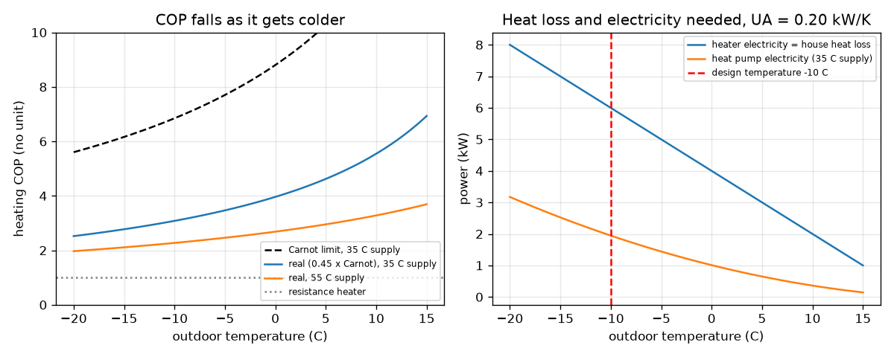
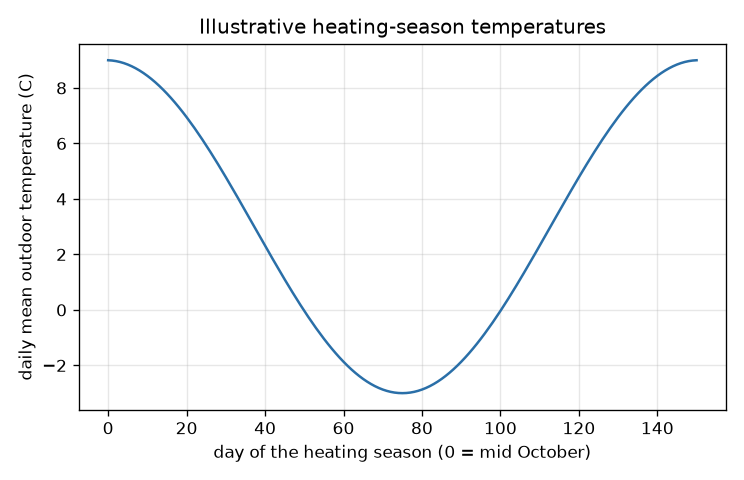

# Session 2: COP, the Carnot limit and sizing a heat pump

*Level 2 (mathematical engineering model) · about 75 minutes · openheatpump*

> This is a simplified educational model. It is not a validated design tool and must not be used for real structures, electrical installations, vehicles, industrial processes or medical decisions.

**Prerequisites**

- Session 1: COP and kelvin.
- Simple algebra: solving a linear equation for one unknown.

**Learning objectives.** After this session you can:

- Derive that the heating COP equals the cooling COP plus 1, and the Carnot limit T_hot / (T_hot - T_cold).
- Compute a real COP as a fraction of Carnot and see how it falls as the outdoor temperature drops.
- Compute the heat loss of a house, UA (T_in - T_out), and size a heat pump for a design temperature.
- Estimate the seasonal electricity and cost of a heater and a heat pump, and solve a design question backwards.

## A. Real-world problem
A family wants to heat a 100 square metre house with a heat pump. How big must the machine be so that the house stays at 20 C on a very cold design night of -10 C? How much electricity will it use over a winter compared with a resistance heater, at an illustrative price of 0.25 per kWh? And how cold must it get outside before the heat pump's COP falls too low to be worthwhile? (General education about a simplified model, not an installation design or personal advice.)

## B. Concept and theory
Energy conservation for a heat pump gives Q_hot = Q_cold + W. Dividing by W: COP_heating = COP_cooling + 1, where COP_cooling = Q_cold / W is the figure a fridge cares about. An ideal reversible (Carnot) machine moves heat so that Q_hot / Q_cold = T_hot / T_cold in kelvin, which gives COP_heating = T_hot / (T_hot - T_cold). A real COP is a fraction eta of this, typically 0.4 to 0.5, and real machines never reach the huge Carnot values for tiny gaps, so we cap the COP at 8. The house loses heat in proportion to the indoor-outdoor temperature difference: Q_loss = UA (T_in - T_out), where UA is in kW per K. To keep the house at T_in the heat pump must deliver Q_loss. Sizing uses a design temperature, a cold outdoor temperature that is reached only rarely. The electricity is Q / COP. Over a heating season we sum 24 h x Q_loss per day for a heater, and 24 h x Q_loss / COP for a heat pump, with a COP for each day's temperature.

| Symbol | Meaning | Unit |
|---|---|---|
| Q_hot, Q_cold | heat delivered to the house, heat taken from outdoors | kW (power) or kWh (energy) |
| W | electrical work or power | kW or kWh |
| T_hot, T_cold | supply temperature and outdoor temperature in kelvin | K |
| eta | real COP as a fraction of Carnot | no unit |
| UA | heat-loss coefficient of the house (area x U-value summed over the envelope) | kW per K |
| T_in, T_out, T_des | indoor, outdoor and design temperature | degrees C |
| c | chosen COP floor in the design question | no unit |

**Assumptions**

- Steady state at each temperature (no thermal mass yet).
- No solar or internal heat gains, so the loss is UA (T_in - T_out); this overestimates both bills.
- The season is 151 days with a cosine temperature profile between 9 C and -3 C, a simplification of a real winter.
- eta = 0.45 and a cap of 8 on the COP are typical values; the tariff of 0.25 per kWh is illustrative only.

$$ Q_{\text{hot}}=Q_{\text{cold}}+W\;\Rightarrow\;\mathrm{COP}_h=\mathrm{COP}_c+1 $$

$$ \mathrm{COP}_h^{\text{Carnot}}=\frac{T_h}{T_h-T_c}\quad(T\text{ in kelvin}),\qquad \mathrm{COP}\approx\eta\,\mathrm{COP}_h^{\text{Carnot}} $$

$$ Q_{\text{loss}}=UA\,(T_{\text{in}}-T_{\text{out}}),\qquad W=\frac{Q_{\text{loss}}}{\mathrm{COP}} $$

$$ E_{\text{season}}=\sum_{\text{days}}\frac{24\,UA\,(T_{\text{in}}-T_{\text{day}})}{\mathrm{COP}(T_{\text{day}})} $$

$$ T_{\text{cold}}=T_h\left(1-\frac{\eta}{c}\right)\quad\text{(outdoor temperature at which }\mathrm{COP}=c\text{)} $$

## C. Visual explanation
The first figure shows two graphs. On the left the Carnot limit and the real COP against the outdoor temperature: both curves fall as the weather gets colder, the real curve is a constant fraction of the Carnot curve, and the 55 C curve is lower than the 35 C curve. On the right the electric power needed to hold the house at 20 C: the heater line is the heat loss itself and rises steeply, while the heat pump line rises much more slowly, so the gap between them grows as it gets colder (2.99 kW at 0 C, 4.05 kW at -10 C). The second figure shows the illustrative daily temperatures of the heating season.

*Left: Carnot limit and real COP. Right: electric power needed by a heater and a heat pump at UA = 0.20 kW/K.*

*The illustrative daily mean temperatures of the 151-day heating season.*

## D. Interactive simulation
Run the lesson (`python start.py 2`), then open the live app: [Session 2: size the heat pump and compare bills](https://krunalpanchal1995.github.io/openheatpump/session-02/) (or `app.html` in this folder). Change the insulation (UA), the design temperature, the supply temperature and eta; watch the bars, the two plots and the seasonal readout update together.

**Challenge.** Reach a seasonal COP of at least 5.0 while the design load stays at or below 5 kW.

## E. Worked example and experiment
**Problem.** A house has UA = 0.20 kW/K and is kept at 20 C. The design temperature is -10 C and the heat pump delivers heat at 35 C with eta = 0.45. Find the design load, the COP and the electric power, then the winter energy and cost for a heater and a heat pump.

1. Design load: Q = 0.20 x (20 - (-10)) = 0.20 x 30 = 6.00 kW. A heat pump must deliver at least 6 kW at -10 C.
2. Carnot COP = 308.15 / (35 - (-10)) = 308.15 / 45 = 6.85; real COP = 0.45 x 6.85 = 3.08.
3. Electric power = 6.00 / 3.08 = 1.95 kW, against 6.00 kW for a resistance heater.
4. Season (151 days with the cosine temperatures): heat needed 12322 kWh. A heater uses 12322 kWh, costing 3080 at 0.25 per kWh.
5. The heat pump uses 2938 kWh (cost 734): a seasonal COP of 12322 / 2938 = 4.19, higher than the design-night COP because most of the season is milder than -10 C.

**Answer.** Design load 6.00 kW; COP 3.08; electric power 1.95 kW against 6.00 kW; season heat 12322 kWh, heater cost 3080, heat pump 2938 kWh and cost 734 (seasonal COP 4.19).

**Experiment.** Measure UA of a real room: with the heating on and the temperature steady, divide the electrical power of a small heater by the indoor-outdoor temperature difference. Then compare the estimated seasonal electricity with last winter's bill. The model will probably overestimate the heat needed because it ignores solar and internal gains, and it uses the daily mean temperature, which hides the cold nights; real COPs are also lower than 0.45 x Carnot when frost and part-load operation are counted.

## F. Assessment and design challenge
**Question type A: Conceptual.** Why does the heating COP of a heat pump fall as the outdoor air gets colder, even though the machine is unchanged?

Hint

Look at the Carnot formula and what happens to the denominator T_hot - T_cold.

Step-by-step solution

The best possible COP is T_hot / (T_hot - T_cold). A colder outdoor air makes the temperature gap in the denominator bigger, so the COP falls. Physically the machine has to lift heat across a larger temperature difference with the same kind of compressor work. The real COP is a roughly constant fraction of this, so it falls too.

**Question type B: Numerical.** A house has UA = 0.15 kW/K, T_in = 20 C, design temperature -8 C, supply temperature 45 C and eta = 0.45. Find the design load, the COP at the design temperature and the electric power.

Hint

Load = UA x (T_in - T_des). COP = 0.45 x 318.15 / (45 - (-8)).

Step-by-step solution

Load = 0.15 x 28 = 4.20 kW. COP = 0.45 x 318.15 / 53 = 2.70. Electric power = 4.20 / 2.70 = 1.55 kW. Sanity check: the electric power is about a third of the heat load, and the COP is lower than the 3.08 of the worked example because the supply temperature is higher (45 C rather than 35 C).

**Question type C: Graph and simulation interpretation.** In the right-hand graph (power against outdoor temperature) the heater line and the heat pump line both rise as it gets colder. Which rises faster and what does the gap between them mean?

Hint

Compare the slopes, and read the gap at 0 C and at -10 C.

Step-by-step solution

The heater line rises faster (slope UA = 0.20 kW per K; the heat pump line has a smaller slope because the COP is also falling slowly). The gap is the electric power saved: 2.99 kW at 0 C and 4.05 kW at -10 C, so the heat pump saves most when it is coldest, even though its COP is lowest then.

**Question type D: Design and optimisation challenge.** Design: a radiator system needs 45 C supply. At which outdoor temperature does the COP fall to 2.0 if eta is 0.4, and if it is 0.5? What does that tell you about choosing a machine?

Hint

Use T_cold = T_hot (1 - eta / c) with kelvin and convert back to Celsius.

Step-by-step solution

T_hot = 318.15 K. For eta = 0.4: T_cold = 318.15 x (1 - 0.4 / 2) = 254.52 K = -18.6 C. For eta = 0.5: 318.15 x 0.75 = 238.61 K = -34.5 C. A machine with a better eta keeps the COP above 2 down to much colder weather; the design temperature of the region must be compared with this limit. A COP of 1 (no better than a heater) is not reached until around -100 C in this simple model; in reality, capacity and compressor limits, not the COP, end a heat pump's usefulness.

Score yourself with [RUBRIC.md](../../RUBRIC.md). Print the [activity sheet](activity_sheet.md) to work on paper.

## Common misconceptions
| Common misconception | What is actually true |
|---|---|
| Heating COP and cooling COP are two unrelated numbers. | For the same machine and the same work, COP_heating = COP_cooling + 1, because the heat delivered also includes the work. |
| The Carnot COP is what a real heat pump achieves. | It is an upper limit; real machines reach about 40 to 50 percent of it (typical, not exact). |
| Sizing a heat pump means matching the average winter heat loss. | It must cover the loss at the design temperature, the cold night, or a backup heater must fill the gap. |
| The seasonal COP equals the COP on the coldest night. | Most of the season is milder than the design night, so the seasonal COP is higher (4.19 against 3.08 in the worked example). |

## Glossary
- **Carnot limit**: the best COP any machine can have between two temperatures, T_hot / (T_hot - T_cold)
- **UA**: heat-loss coefficient of a building: heat leaving per kelvin of temperature difference, in kW per K
- **design temperature**: a rarely reached cold outdoor temperature used to size heating equipment
- **seasonal COP**: total heat delivered over a season divided by total electricity used
- **tariff**: the price per kWh of electricity (illustrative here)

## Finish
1. Do the three coding tasks in [exercises.md](exercises.md).
2. Run `python start.py 2` again after your changes. It ends with the checkpoint; when it prints `PASS`, you are done. (Checkpoint only: `python start.py check 2`.)

Next: [Session 3](../session-03/README.md)
