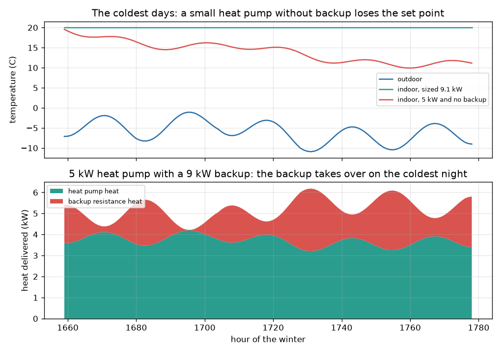
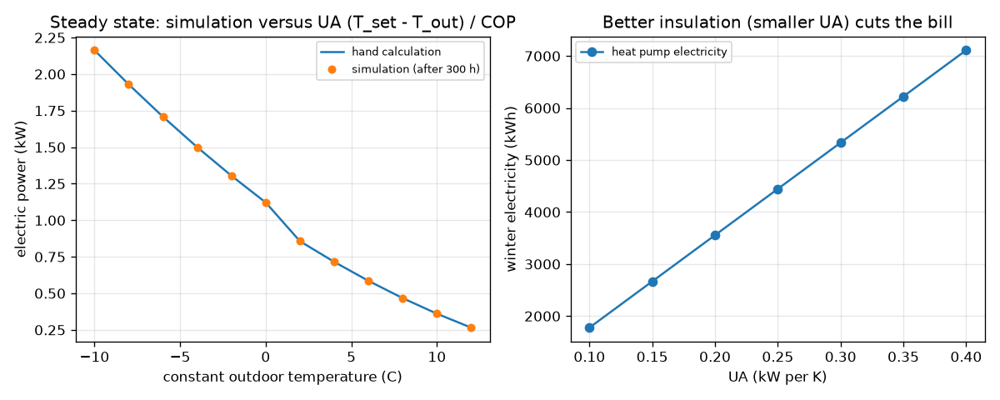

# Session 3: Simulate a winter hour by hour

*Level 3 (simulation and validation) · about 90 minutes · openheatpump*

> This is a simplified educational model. It is not a validated design tool and must not be used for real structures, electrical installations, vehicles, industrial processes or medical decisions.

**Prerequisites**

- Session 1: COP.
- Session 2: heat loss, sizing and the Carnot-fraction COP.
- A feel for a first-order equation (exponential approach to a target).

**Learning objectives.** After this session you can:

- Model a house as one thermal capacity (an RC model) and step it hourly with an exact exponential update.
- Build a COP that depends on outdoor and supply temperature, with a defrost derate, a falling capacity and a backup heater.
- Validate the program against energy conservation, an exact cooling curve and a steady-state hand calculation.
- Run sensitivity tests (UA, supply temperature, tariff) and a failure case: an undersized heat pump on the coldest night.

## A. Real-world problem
Session 2 used daily average temperatures and a house that responds instantly. A real winter has cold nights, a house that takes many hours to cool, a heat pump whose capacity and COP drop in the cold, and a backup heater that rescues it. Can you simulate a whole winter hour by hour, trust the answer, and discover what happens on the coldest night when the heat pump is too small? (General education about a simplified model, not an installation design.)

## B. Concept and theory
The house is one lump with heat capacity C (kWh per K) and loss coefficient UA (kW per K): C dT/dt = Q - UA (T - T_out). The time constant is tau = C / UA, 20 hours for C = 4.0 and UA = 0.20. If the heat Q is constant during an hour, the exact solution is T_next = T_eq + (T - T_eq) exp(-dt / tau) with T_eq = T_out + Q / UA, so the program is stable for any step. The thermostat asks for the heat that would bring the house to the set point at the end of the hour (never negative). The heat pump supplies up to its capacity, which falls with the outdoor temperature (2 percent per kelvin below 7 C, an illustrative figure); a backup resistance heater supplies the rest up to its limit. The COP is eta x Carnot with the supply temperature as a design variable, limited to 8, and multiplied by a defrost factor of 0.9 below 2 C outdoors (an illustrative simple derate). Validation: stored energy change must equal heat supplied minus heat lost, and at constant outdoor temperature the electric power must match UA (T_set - T_out) / COP.

| Symbol | Meaning | Unit |
|---|---|---|
| C | heat capacity of the house | kWh per K |
| UA | heat-loss coefficient | kW per K |
| tau | time constant C / UA | h |
| T, T_out, T_set | indoor, outdoor and set-point temperature | degrees C |
| Q_hp, Q_bu | heat from the heat pump and from the backup heater | kW |
| rated | heat pump capacity at 7 C outdoors | kW |
| T_supply | temperature at which the heat is delivered (design variable) | degrees C |
| tariff | price of electricity | money units per kWh |

**Assumptions**

- One lumped capacity and perfect set-point control at hourly resolution; no night setback.
- The capacity curve, the defrost factor of 0.9 below 2 C and eta = 0.45 are illustrative values, not data of a real machine.
- Fixed supply temperature; no hot water, solar or internal gains, no fan or pump electricity.
- The winter is synthetic (seasonal cosine + daily swing + seeded weather noise), not a real weather file.

$$ C\,\frac{dT}{dt}=Q-UA\,(T-T_{\text{out}}),\qquad \tau=\frac{C}{UA} $$

$$ T_{n+1}=T_{\text{eq}}+(T_n-T_{\text{eq}})\,e^{-\Delta t/\tau},\qquad T_{\text{eq}}=T_{\text{out}}+\frac{Q}{UA} $$

$$ \mathrm{COP}=\eta\,\frac{T_{\text{sup}}}{T_{\text{sup}}-T_{\text{out}}}\times f_{\text{defrost}},\qquad f_{\text{defrost}}=0.9\ \text{if}\ T_{\text{out}}<2\,^\circ\mathrm{C} $$

$$ C\,(T_{\text{end}}-T_{\text{start}})=\sum (Q_{\text{hp}}+Q_{\text{bu}})\Delta t-\sum UA\,(\bar T-T_{\text{out}})\Delta t $$

$$ W_{\text{steady}}=\frac{UA\,(T_{\text{set}}-T_{\text{out}})}{\mathrm{COP}} $$

## C. Visual explanation
The first figure shows the coldest days of the simulated winter. Top: the outdoor temperature and two indoor curves: a heat pump sized for -10 C holds 20 C, while a 5 kW heat pump with no backup lets the house sag to about 11 C. Bottom: for a 5 kW pump with a 9 kW backup, the stacked heat shows the backup taking over on the coldest night. The second figure shows two validation results: simulation dots lying on the hand-calculation line for the steady-state electric power, and the winter electricity falling as the insulation improves (smaller UA).

*The coldest days: a sized heat pump holds 20 C; a small one without backup falls to about 11 C; with backup the extra heat shows in red.*

*Left: simulated steady-state electric power against the hand calculation. Right: winter electricity against UA.*

## D. Interactive simulation
Run the lesson (`python start.py 3`), then open the live app: [Session 3: a cold week with a heat pump](https://krunalpanchal1995.github.io/openheatpump/session-03/) (or `app.html` in this folder). Use the cold-week app: move the insulation, supply temperature, heat pump size, backup and tariff sliders and watch the temperature, cost and coldest-hour views change.

**Challenge.** With no backup heater (backup = 0), keep the house at 19.9 C or more all week by choosing the heat pump size.

## E. Worked example and experiment
**Problem.** The house (UA = 0.20 kW/K) is held at 20 C while it is 0 C outdoors for a long time. The supply temperature is 35 C. Find the heat needed, the COP including the defrost derate, and the electric power, and compare with the simulation.

1. Heat needed: Q = 0.20 x (20 - 0) = 4.00 kW.
2. Carnot COP = 308.15 / 35 = 8.80; with eta = 0.45 the COP is 3.962.
3. It is below 2 C outdoors, so the defrost factor 0.9 applies: COP = 3.962 x 0.9 = 3.566.
4. Electric power W = 4.00 / 3.566 = 1.122 kW.
5. The simulation at constant 0 C (300 hours) gives 1.1218 kW in the last hour: they agree.
6. Season (seeded winter, a heat pump rated 9.09 kW sized for -10 C): the heat pump uses 3556 kWh (cost 889, seasonal COP 3.72); a resistance heater uses 13244 kWh (cost 3311), a ratio of 3.7 to 1.

**Answer.** Heat 4.00 kW, COP 3.566, electric power 1.122 kW, matching the simulation; over the seeded winter the heat pump costs 889 against 3311 for a heater.

**Experiment.** Log the indoor and outdoor temperature of a real house (or a single room) every hour for a cold week while the heating is off for one night, and fit the cooling curve T = T_out + (T0 - T_out) exp(-t / tau) to find tau. Compare it with C / UA. The model will be too simple: real houses have air, furniture and walls with different time constants, heat gains from sun and people, and wind-dependent losses. The model also assumes a perfect thermostat, which a real house does not have.

## Real-world application and mini-project: Size a heat pump for a house and estimate its yearly heating cost
A house has UA = 0.26 kW/K, a 20 C set point and radiators that need a 45 C supply temperature. Its backup heater is 6 kW. Use `simulate` from Session 3 with the seeded winter and find the smallest rated heat pump capacity (in steps of 0.5 kW) for which the backup heater supplies less than 2 percent of the heat. Compare the winter electricity cost with a resistance heater at 0.25 per kWh. This is general education about a simplified model, not an installation design or personal advice.

**Deliverable:** A script that prints, for rated capacities from 3 to 12 kW, the backup share of the heat, the winter cost and the lowest indoor temperature; names the smallest passing capacity; and saves a plot of winter cost against rated capacity next to the cost of a resistance heater.

**Success looks like:** The smallest passing capacity is reported (it is 8.5 kW, with a backup share of 1.4 percent), its winter cost is about 1476 against about 4304 for a resistance heater, and you can explain why this is smaller than the 11.8 kW that a design-temperature rule of thumb gives.

## F. Assessment and design challenge
**Question type A: Conceptual.** On a single very cold night a house with a large heat capacity needs less backup heat than a lightweight house with the same UA. Explain why, and say why it does not help in a long cold spell.

Hint

Think about the stored heat C (T - T_out) and the time constant tau = C / UA.

Step-by-step solution

A house with a big heat capacity cools slowly (a long time constant), so on one cold night it can lose a degree or two instead of needing extra heating power; the stored heat helps cover the shortfall. In a long cold spell the stored heat is used up, and the heat pump (plus backup) must deliver the full loss UA (T_in - T_out) all the time, so the thermal mass delays but does not remove the need for capacity.

**Question type B: Numerical.** If the heating fails completely while it is 0 C outdoors, UA = 0.20 kW/K and C = 4.0 kWh/K, how long does the house take to cool from 20 C to 15 C?

Hint

T = T_out + (T0 - T_out) exp(-t / tau). Solve for t with tau = C / UA.

Step-by-step solution

tau = 4.0 / 0.20 = 20 h. 15 = 0 + 20 exp(-t / 20) gives exp(-t / 20) = 0.75, so t = 20 ln(4/3) = 5.75 h. Sanity check: it takes much less than one time constant (20 h) because the drop of 5 K is only a quarter of the 20 K gap.

**Question type C: Graph and simulation interpretation.** In the figure, the 5 kW heat pump with backup shows the backup heater switching on in the coldest hours. Estimate the capacity of the 5 kW pump at -11 C and the backup power needed, if the house loss at that temperature is 6.2 kW.

Hint

Capacity = rated x (1 + 0.02 x (T_out - 7)).

Step-by-step solution

Capacity = 5 x (1 + 0.02 x (-11 - 7)) = 5 x 0.64 = 3.2 kW. The loss is 0.20 x 31 = 6.2 kW, so the backup must give about 3.0 kW. This is why the backup share and the electricity bill jump on the coldest nights: backup heat has a COP of 1 instead of about 3.

**Question type D: Design and optimisation challenge.** Design: a poorly insulated house has UA = 0.30 kW/K, 20 C set point, 45 C supply, design temperature -10 C, and a 9 kW backup. Choose a rated capacity: compare the design-temperature size with 10 kW and 8 kW using the seeded winter.

Hint

Design size = load / capacity factor at -10 C, where the factor is 0.66. Then run simulate() for each size and compare cost and backup share.

Step-by-step solution

Load at -10 C is 0.30 x 30 = 9.0 kW, so the rated size is 9.0 / 0.66 = 13.6 kW. Simulation: 13.6 kW costs 1663 with 0.02 percent of the heat from backup; 10 kW costs 1697 (+2 percent) with 1.2 percent backup; 8 kW costs 1811 (+9 percent) with 5.0 percent backup. A smaller machine costs less to buy (capital cost not included here) but uses more backup. A reasonable choice is around 10 kW: the running cost is within 2 percent of the largest machine. Assumptions: illustrative capacity curve and a synthetic winter; a real design needs local weather data and a professional calculation.

Score yourself with [RUBRIC.md](../../RUBRIC.md). Print the [activity sheet](activity_sheet.md) to work on paper.

## Common misconceptions
| Common misconception | What is actually true |
|---|---|
| A heat pump sized for the average winter day is enough. | It must cover the coldest nights, or a backup heater supplies the difference at a COP of 1. |
| If the simulation runs and gives smooth curves, it is right. | Check energy conservation and a hand calculation: here the residual is below 1e-6 kWh and the steady state matches to 4 digits. |
| Insulation only matters for the heating season total, not for sizing. | A smaller UA lowers the design load, so it allows a smaller machine, and cuts the electricity bill proportionally. |
| The house temperature jumps as soon as the heating is switched off. | The thermal mass makes it fall exponentially with the time constant tau = C / UA (20 h here). |

## Glossary
- **thermal mass**: the ability of a building to store heat, measured by its heat capacity C
- **time constant**: tau = C / UA: how fast the house cools or warms (20 h in this model)
- **defrost**: a cycle that removes frost from the outdoor coil, which costs some efficiency
- **backup heater**: a resistance heater that supplies the heat the heat pump cannot
- **energy conservation check**: comparing stored energy change with heat in minus heat lost to test a simulation
- **RC model**: a lumped model with one heat capacity and one thermal resistance, like a capacitor and a resistor

## Finish
1. Do the three coding tasks in [exercises.md](exercises.md).
2. Run `python start.py 3` again after your changes. It ends with the checkpoint; when it prints `PASS`, you are done. (Checkpoint only: `python start.py check 3`.)

Next: the [roadmap](../../promo/roadmap.md). Session 4 is yours to build.
